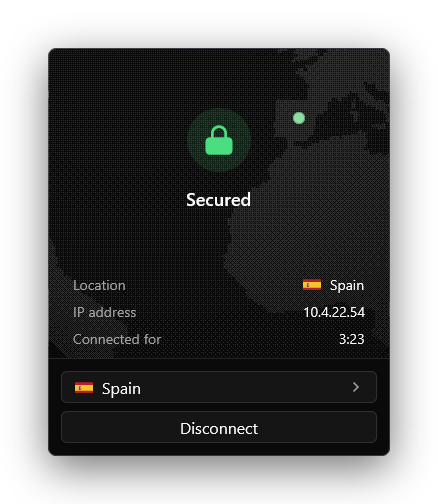

# vyprvpn-native

```sh
cargo build --workspace
```

Binaries land in `target/debug/`.

## What it is

- A minimal VyprVPN client.
- `VyprLite`: the tray app. Runs unprivileged.
- `vyprlite-helper`: the privileged helper.

<p align="center">
  
  
  
</p>

## Quick start

1. Build: `cargo build --workspace`
2. Test: `cargo test --workspace`
3. Run the helper: `target/debug/vyprlite-helper --console`
4. Run the tray app: `target/debug/VyprLite --console`

## Run for development

```sh
target/debug/vyprlite-helper --console
target/debug/VyprLite --console
```

- No elevation needed.
- Both use a pipe only the current user can reach.
- They never touch an installed service.
- The console helper exits 5 s after the last tray app disconnects.

## Build a distributable (Windows)

```sh
cargo xtask dist
```

This writes `dist/` with:

- `VyprLite.exe` (release build)
- `vyprlite-helper.exe` (release build)
- `wireguard.dll` (official WireGuardNT 1.1, amd64)

> **Never commit the DLL.**

How the DLL is fetched:

- Source: the WireGuardNT zip on download.wireguard.com.
- Cached under `target/wireguard-nt/`.
- The build fails unless the zip matches the pinned SHA256.
- The build fails unless the DLL has a valid Authenticode signature from WireGuard LLC.

## Install (Windows)

> **Needs an elevated prompt.** Run it as the user who will use VyprLite.

1. `xcopy /e /i dist "C:\Program Files\VyprLite"`
2. `cd /d "C:\Program Files\VyprLite"`
3. `vyprlite-helper.exe install`

> **Folder permission check:** install refuses any folder that anyone except SYSTEM, Administrators and TrustedInstaller can change. That includes `dist\` itself. It also refuses if anyone else could rename a folder above it.

Why: the service runs `vyprlite-helper.exe` and loads `wireguard.dll` as SYSTEM.

What install does:

- Registers the `VyprLiteHelper` service (manual start, LocalSystem).
- Lets you start and query the service without elevation.
- Starts `VyprLite.exe` unelevated at your next login.

At runtime:

- The tray app starts the service itself.
- The service stops 5 s after the tray app exits, unless a tunnel is up.

> **Moved the folder?** Run `vyprlite-helper.exe install` again.

## Install (macOS)

> **Needs `sudo`.** Run it from your own account.

1. `cargo build --release`
2. `cd target/release` (or any folder holding `vyprlite-helper` and `VyprLite`)
3. `sudo ./vyprlite-helper install`

What install does:

- Copies the helper to `/Library/PrivilegedHelperTools/com.vyprlite.helper` (root-owned).
- Copies the tray app to `/usr/local/libexec/vyprlite/VyprLite` (root-owned).
- Loads the `com.vyprlite.helper` launch daemon.
- Adds a launch agent in `~/Library/LaunchAgents` that starts the tray app at your next login.

Root ownership means no other account can replace what root runs.

At runtime:

- The daemon runs as root, only on demand.
- The tray app touches `/var/db/vyprlite.wake` to start it. Only you can write that file.
- The daemon exits 5 s after the tray app does, unless a tunnel is up.
- Only root and you can connect to its socket, `/var/run/vyprlite.sock`.

## Uninstall

Both commands are safe to run twice.

**Windows** (elevated prompt):

```bat
vyprlite-helper.exe uninstall
```

- Disconnects the VPN.
- Removes the service and the login autostart entry.
- Deletes the data directory, including the stored login.

**macOS:**

```sh
sudo /Library/PrivilegedHelperTools/com.vyprlite.helper uninstall
```

- Disconnects the VPN and unloads the launch daemon.
- Removes both launch plists and the installed binaries.
- Removes the wake file and the socket.
- Deletes `/Library/Application Support/VyprLite`, including the stored login.

## Where things live

| | Windows | macOS |
| --- | --- | --- |
| Data directory | `%SystemRoot%\System32\config\systemprofile\AppData\Local\VyprLite` | `/Library/Application Support/VyprLite` (only root can open it) |
| Log | `helper.log` | `helper.log` |
| Panics | `crash.log` | `crash.log` |
| Stored login | `credentials.bin` (encrypted) | `credentials.json` (mode 0600) |
| Helper binary | `C:\Program Files\VyprLite\vyprlite-helper.exe` | `/Library/PrivilegedHelperTools/com.vyprlite.helper` |
| Tray app binary | `C:\Program Files\VyprLite\VyprLite.exe` | `/usr/local/libexec/vyprlite/VyprLite` |
| Service | `VyprLiteHelper` | `com.vyprlite.helper` launch daemon |
